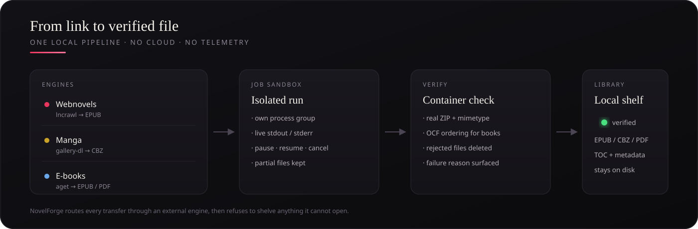

# NovelForge


A private desktop download studio for **webnovels**, **manga** and **e-books**.
NovelForge is a Tauri 2 shell over three battle-tested downloaders — `lncrawl`,
`gallery-dl` and `aget` — with a dark glass UI, live process output, job
controls and strict container verification before anything reaches your shelf.

- **Local only.** No accounts, no cloud, no telemetry.
- **Real processes.** Every transfer is an external binary spawned in its own
  process group; stdout and stderr stream into the terminal dock.
- **Verified output.** EPUBs must be a real ZIP whose `mimetype` entry is exactly
  `application/epub+zip`. Books additionally enforce OCF ordering. Invalid
  containers are deleted immediately and the job is reported as rejected.

---

## Stack

| Layer     | Choice                                                        |
| --------- | ------------------------------------------------------------- |
| Shell     | Tauri 2 (Rust backend, custom undecorated window)             |
| Frontend  | React 19 + TypeScript 6 + Vite 8                              |
| Styling   | Tailwind CSS 4, Cormorant Garamond / Inter / JetBrains Mono   |
| Runtime   | Tokio, `walkdir`, `zip`, `serde`, `sysinfo`-free process code |

## Engines

| Engine       | Tool          | Input                     | Output             |
| ------------ | ------------- | ------------------------- | ------------------ |
| Webnovels    | `lncrawl`     | direct page URL           | EPUB               |
| Manga        | `gallery-dl`  | gallery-dl manga page URL | CBZ / ZIP          |
| E-books      | `aget`        | title or author           | EPUB / PDF         |

Exact invocations used by the Rust backend:

```bash
# Webnovels — non-interactive, every chapter, EPUB
lncrawl -ll crawl "<URL>" -f epub --all --noin

# Manga — chapter numbers, one CBZ with chapter folders, extractor metadata
gallery-dl "<URL>" --child-filter "chapter is not None and str(chapter) in ('1','1.0')" \
  --no-input --no-colors --option lang=en --write-info-json --sleep-request 1.0

# Books — Playwright headless, best result, optional language
aget "<title or author>" --format epub --auto --output "<job dir>" --headless [--lang en]
```

`lncrawl` writes artifacts into its own data directory (`~/.lncrawl`), so the
backend captures the printed artifact path (and falls back to recently modified
artifacts) and moves the result into the job sandbox before verification.



---

## Install

Grab `novelforge-windows.zip` or `novelforge-linux.zip` from the newest
**Actions → `windows-build` / `linux-build` → Artifacts** run (or from the
release page, once one is attached). Leave the ZIP in your Downloads folder,
then run one block: it unpacks the archive, installs the system packages,
installs the three download engines, and launches the NovelForge installer.

### Windows — PowerShell (not `cmd`)

> Use **Windows PowerShell** or **PowerShell 7**. This block is not for
> `cmd.exe` — `Expand-Archive` and the backslash paths do not work there.

```powershell
cd $HOME\Downloads
Expand-Archive -Force .\novelforge-windows.zip .\novelforge
cd .\novelforge

winget install -e --id Python.Python.3.12 --accept-package-agreements --accept-source-agreements
winget install -e --id Git.Git --accept-package-agreements --accept-source-agreements

powershell -ExecutionPolicy Bypass -File .\scripts\install-tools.ps1

$setup = Get-ChildItem .\NovelForge_*-setup.exe | Select-Object -First 1
Start-Process $setup.FullName
```

If `winget` had to install Python or Git, close and reopen PowerShell before the
last two commands so the new `PATH` is visible. Everything installs under
`%LOCALAPPDATA%\novelforge`; no administrator rights and no WSL are needed.

### Linux — Bash

```bash
cd ~/Downloads
unzip -o novelforge-linux.zip -d novelforge
cd novelforge

if command -v pacman >/dev/null; then
  sudo pacman -S --needed --noconfirm base-devel curl python git unzip
elif command -v apt >/dev/null; then
  sudo apt update && sudo apt install -y build-essential curl python3 python3-venv git unzip
fi

bash ./scripts/install-tools.sh

bash ./scripts/install-linux-desktop.sh ./NovelForge_*.AppImage --launch
```

The desktop step copies the AppImage to `~/.local/bin/novelforge.AppImage`,
installs its icon and writes `~/.local/share/applications/novelforge.desktop`, so
NovelForge appears in the application launcher like any other app. It also adds
a `novelforge` command and starts the app once. Re-run it after downloading a
newer AppImage.

The AppImage needs FUSE 2 on some distributions. If it refuses to start, run
`./NovelForge_*.AppImage --appimage-extract-and-run`. A `.deb` is in the same
ZIP if you prefer `sudo apt install ./novelforge_*.deb`; the package manager
writes the launcher entry itself.

### What the blocks install

| Step             | Windows                                   | Linux                                             |
| ---------------- | ----------------------------------------- | ------------------------------------------------- |
| System packages  | Python 3.12 + Git via `winget`            | Python, Git, curl, distro build tools             |
| Engines          | `%LOCALAPPDATA%\novelforge\bin`           | `~/.local/bin` + `~/.local/share/novelforge/tools` |
| App              | NSIS installer                            | AppImage registered in the launcher / `.deb`      |

`install-tools` installs `lncrawl` from a pinned source commit and applies the
NovelForge patches, installs `gallery-dl` in its own virtualenv, and installs
`aget` plus a headless Chromium (about 170 MB). It is safe to re-run.

The ZIP also contains `SHA256SUMS.txt`. Verify the installer before running it:

```powershell
Get-FileHash .\NovelForge_*-setup.exe -Algorithm SHA256
Get-Content .\SHA256SUMS.txt
```

```bash
sha256sum -c SHA256SUMS.txt
```

### Build from source

NovelForge is free software under **GPL-3.0-or-later**. The complete source for
every published build travels with the release — the matching tag in this
repository or an attached source tarball. Run `npm install && npm run tauri dev`
for development mode and `npm run tauri build` to write bundles to
`src-tauri/target/release/bundle/`.

On Linux, `bash ./scripts/install-linux-desktop.sh` with no arguments finds the
freshly built AppImage and registers it in the launcher.

---

## Using the dashboard

1. Pick an engine in the control deck.
2. Paste a direct `http(s)` page URL for Webnovels/Manga, or a title/author for
   Books.
3. Adjust per-job options (chapter range, throttle, language; manga also exposes parallel jobs).
4. Press **Initialize Download**. The task card shows live progress, speed and
   ETA; the terminal dock streams output, filterable per job.

Task controls:

- **Pause / Resume** — `SIGSTOP` / `SIGCONT` on the process group.
- **Cancel** — `SIGTERM`, then `SIGKILL` after a grace period; partial files stay.
- **Reveal** — opens the output in the file manager (sandboxed).
- **Clear finished** — removes completed/failed/cancelled cards from the queue.

The right rail shows aggregate session progress, throughput, the up-next queue
and the most recent verified library outputs. It is visible at ≥1280 px wide.

---

## Title, alias and author resolution

A webnovel job starts from a pasted page URL or a name. The resolver never
guesses silently:

- **Title** (default) searches the selected sources, then reads the detail page
  for the real title and any advertised alternative names (JSON-LD
  `alternateName` or an “Alternative names” row). When nothing matches, it asks
  AniList and Wikipedia for a canonical title and searches the sources again.
  AniList’s native title also lets a Hangul/CJK query resolve to the English
  title the source actually indexes.
- **Author** (the Title/Author toggle, or an `author:` / `by:` prefix) reads
  each source’s author page (`/author/<name>`), which lists the whole
  bibliography even when the site search only matches titles. NovelFire and
  NovelPhoenix declare an author-page template; sources without one fall back
  to search plus author verification on the candidate pages. The failure names
  the sources that were consulted.
- Auto mode runs the author pages alongside the search, so typing an author’s
  name lists every novel credited to them (one entry per title, preferring a
  download-ready source) without a second pass.
- Matching folds diacritics and full-width forms, ignores punctuation and
  common filler words, and inspects candidates round-robin across sources so a
  noisy source cannot crowd out the real hit.

Each result shows its confidence, a match type (direct URL, title, alias or
author) and the sources that were searched. Other plausible hits are listed as
one-click alternatives. A match below 85% is shown for review with a warning;
an automatic title download refuses it, so a weak guess can never start on its
own. The studio still lets you start it explicitly or switch to an alternative.

---

## Library and legacy archives

The Library page lists structured downloads (cards with a chapter index) and,
separately, loose archive files. If an older NovelForge folder contains a
single EPUB but no `metadata.json`, the **Unstructured archives** queue offers
**Adopt**. Adoption audits the EPUB, extracts its title/author/cover, splits the
spine into `chapters/` XHTML files and writes `metadata.json` beside the
original. The EPUB itself is never renamed, rewritten or deleted, and running
Adopt again is a no-op. Adopted cards are marked **Migrated** and do not offer
retry/update because there is no remote source to refresh. Other formats and
ambiguous folders stay visible as **Archive only** with the reason shown.

Every structured folder also contains a chapter index beside `metadata.json`:

- `index.json` — compact chapter list with number, title, source URL, volume,
  downloaded flag and local file path.
- `chapters.html` — a self-contained, searchable page that opens in any browser
  and links downloaded chapters. It needs no network access and works for
  partial folders too.

The index is written after a download or adoption and backfilled automatically
when the Library scans an older folder. It never modifies the bundled EPUB.

Split chapter files are cleaned before they are written: duplicate leading
titles, `aria-hidden` numbering markers and known navigation/ad/donation blocks
are removed. Story paragraphs are preserved, and the bundled EPUB is left
untouched.

### Disk usage and cleanup

The Library page measures the real folder tree rather than guessing from file
counts. Its **Disk usage** panel separates:

- **Library** — every visible file under the download root.
- **Partial output** — incomplete structured folders, kept on purpose for retry.
- **Engine work files** — per-job crawler trees under the hidden
  `.novelforge-work/` container.

Each novel card shows its own size. Two explicit actions sit beside the panel:

- **Delete partial downloads** removes incomplete structured folders only.
  Complete downloads are never included and a folder a job is still writing is
  kept; the confirmation states the folder count and bytes first.
- **Clean work files** removes abandoned crawler trees. Queued, running and
  paused jobs keep their tree.

Successful imports already delete their own work tree. Settings →
**Remove engine work files after import** turns that off when debugging a source
adapter; a kept tree is reported in the job log and can be removed from the
Library page later.

**Library quota.** Settings → **Library quota** accepts a size in GB, where `0`
means unlimited (the value is clamped to 100 TiB). A brand-new download is
refused before any network request once the library reaches the quota. Updates,
retries and operations on an existing folder are never blocked, so an
over-quota library can still be repaired. Nothing is deleted to enforce the
quota. The Webnovels panel shows an over-quota banner and, before an
all-chapters run of 300+ chapters, a confirmation with an estimated size and
the projected library total.

---

## Source availability and translations

NovelForge does not bundle a raw Korean-language (`ko`) crawler. Korean-origin
novels are reachable through English-language aggregators that publish
translations, and the search panel labels those sources as **Korean-origin ·
best effort** rather than promising that a given title exists everywhere.

Source catalogues are not interchangeable. NovelFire, for example, has removed
some Korean-origin titles for copyright reasons, so a search there may return
nothing for a novel that NovelPhoenix carries. The search panel shows each
source's site language and any known availability note, and empty results list
which sources actually answered instead of claiming the book does not exist.

You can always paste a direct page URL from any English translation site; the
adapter registry only controls whether metadata and index completeness are
pre-verified, not whether a direct URL can be tried.

---

## Verification rules

Verification lives in `src-tauri/src/verify.rs` and is independent of whatever
the downloader printed.

**EPUB (all engines)**

- File is a readable ZIP archive.
- A `mimetype` entry exists and decompresses to exactly
  `application/epub+zip`.
- Truncated/empty/invalid archives fail closed and are deleted.

**EPUB produced by Books (`aget`)**

- All of the above, plus OCF strictness:
  - `mimetype` is the first entry in the central directory.
  - `mimetype` is stored uncompressed.

**Manga**

- `cbz` / `zip` must be valid ZIP archives with at least one entry.
- `dir` output must contain at least one image file.

**Other**

- PDF files must start with the `%PDF-` signature.
- Unknown extensions must be non-empty; they are never treated as EPUBs.

On failure the file is removed, the task is marked **failed**, and a
`SECURITY` / rejection line is written to the terminal dock.

---

## Sandbox

All outputs are written under the configured download root (default
`~/Downloads/NovelForge`). `reveal_path`, `verify_path` and library scans
canonicalize their target and refuse anything outside that root. Arguments are
passed as vectors to `Command` — no shell is involved, so pasted URLs cannot
inject commands. Input length and control characters are validated before a job
is created.

Settings are persisted to `~/.config/com.novelforge.app/settings.json`.

---

## Project layout

```
novelforge/
├── scripts/install-tools.sh       # engine installer
├── scripts/apply-lncrawl-patches.sh
├── scripts/patches/               # pinned lncrawl source fixes
├── scripts/check.sh               # offline gate: Rust + frontend + build
├── scripts/source-smoke.sh        # opt-in live source matrix
├── docs/QA_MATRIX.md              # offline/live coverage and merge gate
├── docs/images/                   # README banner and pipeline artwork
├── .github/workflows/ci.yml       # frontend + Rust offline CI
├── .github/workflows/linux-build.yml # AppImage + deb release ZIP
├── .github/workflows/windows-build.yml # NSIS release ZIP
├── src/                           # React frontend
│   ├── components/
│   │   ├── dashboard/             # hero, control deck, task cards, rails
│   │   ├── shell/                 # titlebar, sidebar, terminal, right rail
│   │   └── ui/                    # progress, badges, notices, mark, glyphs
│   ├── hooks/useDownloadManager.ts# IPC state + event subscriptions
│   ├── lib/                       # tauri bridge, formatting, demo fixtures
│   ├── pages/                     # Dashboard, Library, Settings, Guardrails, About
│   ├── test/                      # Vitest setup
│   └── styles.css                 # Tailwind theme, glass/terminal utilities
└── src-tauri/
    ├── src/
    │   ├── commands.rs            # invoke handlers, library scan, path sandbox
    │   ├── process.rs             # spawn, log pumps, progress, artifacts, controls
    │   ├── tools.rs               # tool resolution and version probing
    │   ├── verify.rs              # EPUB / CBZ / PDF verification
    │   ├── settings.rs            # load/save/validate configuration
    │   ├── model.rs               # shared types
    │   ├── error.rs               # AppError → serialized command errors
    │   └── lib.rs                 # app setup, state, invoke registration
    ├── tests/offline_export.rs    # fixture EPUB through the export pipeline
    └── tauri.conf.json
```

The frontend talks to Rust through typed `invoke` wrappers in
`src/lib/tauri.ts`. Rust pushes updates as Tauri events:

| Event               | Payload                    |
| ------------------- | -------------------------- |
| `novelforge://log`  | `{ jobId, stream, line }`  |
| `novelforge://task` | full `DownloadTask`        |
| `novelforge://library` | timestamp (refetch library) |

---

## Development checks

Every change must pass the offline gate:

```bash
./scripts/check.sh
```

It runs the Rust unit tests, the offline export integration test, the frontend
component tests (Vitest) and the production TypeScript/Vite build. The same
steps run in `.github/workflows/ci.yml`.

Live checks are opt-in because they depend on third-party sites:

```bash
NOVELFORGE_ALLOW_LIVE=1 ./scripts/source-smoke.sh            # full source matrix
NOVELFORGE_ALLOW_LIVE=1 ./scripts/source-smoke.sh novelfull  # one target
```

`docs/QA_MATRIX.md` lists which test proves which behaviour, the live smoke
matrix, the cancellation check and the gate a new source must pass before it
can merge.

Disk accounting has its own debug probes (they drive the same commands as the
UI):

```bash
cd src-tauri
NOVELFORGE_QA_DOWNLOAD_DIR=/tmp/opencode/storage-check NOVELFORGE_QA_STORAGE=report  cargo run --quiet
NOVELFORGE_QA_DOWNLOAD_DIR=/tmp/opencode/storage-check NOVELFORGE_QA_STORAGE=work    cargo run --quiet
NOVELFORGE_QA_DOWNLOAD_DIR=/tmp/opencode/storage-check NOVELFORGE_QA_STORAGE=partials cargo run --quiet
```

`report` prints the library/partial/work totals and each novel's size; `work`
and `partials` run the two explicit cleanup actions. Forcing a tiny quota with
`NOVELFORGE_QA_QUOTA_BYTES=1` proves the gate refuses a new download before the
resolver runs, and `NOVELFORGE_QA_KEEP_WORK=1` leaves the crawler tree in place
so the keep/cleanup path can be inspected.

---

## Troubleshooting

| Symptom | Fix |
| --- | --- |
| Guardrails shows a tool as **missing** | Run `./scripts/install-tools.sh`, ensure `~/.local/bin` is on `PATH`, or set an explicit path in Settings. |
| Manga fails immediately | `gallery-dl --version` must work; check the binary path in Settings. If a title has no chapters in the configured manga language, set it to blank (all translations) or another language. |
| Books opens a browser or hangs | Re-run the Playwright step: `~/.local/share/novelforge/tools/aget-venv/bin/python -m playwright install chromium`. `--headless` is always passed. |
| Webnovel reports success but no file | Check the terminal for the printed artifact path; the backend imports from `~/.lncrawl/novels/**/artifacts/`. |
| EPUB rejected for Books | `aget` returned a non-OCF file. The file is deleted by design; try another edition. |

## Responsible use

NovelForge is a local front-end for third-party tools. Download only material
you are allowed to keep, follow each source's terms, and respect the law where
you live. No DRM circumvention is included or supported. The engines are
maintained by their own communities; NovelForge ships no catalogue data and
makes no claim about availability.

## License

NovelForge is free software: you can redistribute it and/or modify it under the
terms of the **GNU General Public License** as published by the Free Software
Foundation, either version 3 of the License, or (at your option) any later
version.

It is distributed in the hope that it will be useful, but **without any
warranty**; without even the implied warranty of merchantability or fitness for
a particular purpose. See [LICENSE](LICENSE) for the full text.

Because the license is copyleft, anyone who distributes a modified NovelForge
must also make the modified source available under the same terms.

The three engines are **not** bundled: `install-tools` fetches them from their
upstream projects, and each keeps its own license (lncrawl and gallery-dl are
GPL, `aget` is installed from upstream and is not redistributed).
